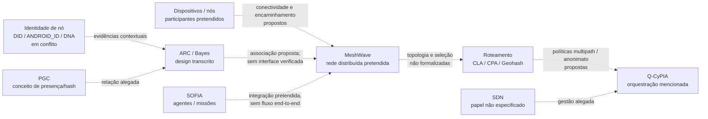

# Visão geral do ecossistema MeshWave

## Metadados

| Campo | Valor |
|---|---|
| ID curatorial | `DOM-01` |
| Status | `REVISÃO` — versão provisória; cobertura não abrangente |
| Versão do documento | `0.3.5` |
| Última atualização | `2026-10-26` |
| Curador | `Manus — curadoria BCE MeshWave` |
| Confiança geral | `baixa a média` para intenção conceitual; baixa para arquitetura vigente e estado do produto |
| Fontes desta versão | Classificações L001–L003, relatório F1.7, fontes primárias da seção 8, E001–E006 auditadas em F3.1 e especificação arquitetural E011 |

## 1. Resumo executivo

O material curado apresenta **MeshWave como uma iniciativa/ecossistema cuja visão é oferecer comunicação distribuída em malha**, relacionando dispositivos/nós, roteamento resiliente, identidade e confiança. A auditoria direta de E001/L001-01 confirma que a fonte formula essa visão, mas também mistura explicação gerada, resultados de busca, homônimos externos e roadmap. Em formulações de sinergia, **SOFIA** aparece como inteligência/orquestração de agentes, enquanto **ARC**, **PGC** e **Q-CyPIA** são associados a autenticação contextual, prova/contexto de presença e seleção de rotas com anonimato. Essas relações descrevem **intenção, proposta ou síntese de fontes**; não constituem, por si, uma arquitetura implementada.

A evidência disponível nesta etapa é heterogênea: transcrições de conversas, planos, diagramas/capturas e fragmentos de código copiados para conversas. No conjunto amostrado pela F1.7, **não foi confirmado código executável anexado nem resultado verificável de build, teste, execução, upload ou produção em 29/29 conjuntos examinados**. Esse resultado é limitado à amostra — 29 de 273 conjuntos (10,62%) — e não demonstra inexistência de código ou operação fora dela.

A auditoria direta de E002/L001-02 encontrou uma matriz de roadmap por quatro fases e uma captura que **alega** existir um protótipo Python; nenhum código ou resultado acompanha a alegação, portanto isso não altera o estado de implementação.

A auditoria direta de E003/L001-03 confirma uma grade visual com células numeradas e regiões coloridas, mas não encontra legenda, CRS, escala ou regra de roteamento. A transcrição relata uma imagem gerada a partir de uma planilha e aprovada como referência; a planilha e o arquivo de contexto anunciados não estão entre os cinco artefatos, e a captura `FULL.png` mostra a transferência de contexto, não o desenho nem sua geração técnica.

A auditoria direta de E004/L001-04 encontrou design ARC/Bayes e roteiros de integração Kotlin/Ktor/Vue e Android em uma transcrição repetitiva; `FULL.png` é uma captura de conversa. A presença de código transcrito e planos não comprova projeto compilável, simulador executável ou integração no MeshWave, e literais sensíveis de exemplo foram redigidos.

A auditoria direta de E005/L001-06 confirma que a fonte registra uma proposta de dossiê integrado e atribui papéis conceituais a MeshWave, SOFIA, ARC, PGC e Q-CyPIA. A maior parte do material é plano editorial, comandos/instruções de curadoria e conversa repetida. A captura mostra instruções históricas sobre Git/PAT e pedidos de acesso remoto, mas não demonstra acesso, movimentação de arquivos, integração de módulos ou criação do dossiê; hashes 4/4 coincidem com o pré-registro.

A auditoria direta de E006/L002-02 confirma principalmente um plano editorial/visual para ilustrações de um site/documentação MeshWave. A transcrição lista 14 elementos em cinco categorias, incluindo Geohash, CPA/CLA, cache, fluxos de busca/atualização, arquitetura e requisitos; afirma que dois gráficos já teriam sido criados. Porém, nenhum arquivo de saída gráfica íntegro está no conjunto: `code_blocks.txt` tem apenas linhas vazias/separador e uma referência de caminho local. `FULL.png` mostra erro interno, tarefa em 3/7 e parada por contexto longo, embora o replay apareça como concluído. O diagrama em `img_000.jpg` (WebP por assinatura) tem rótulos e fronteiras sobrepostos/ilegíveis. A fonte não define esquema normativo, algoritmo, contrato, implementação ou interoperabilidade.

Assim, este documento define um **mapa de conceitos e relações candidatos para orientar a curadoria**, não uma descrição certificada do produto atual. O diagrama e as definições abaixo distinguem o que foi observado em registros do que continua proposto, ambíguo ou não verificado.

## 2. Escopo e limites

Este documento oferece uma visão de orientação do ecossistema e ligações entre domínios; não substitui os documentos especializados de arquitetura, rede, identidade, ARC, SOFIA, aplicações ou segurança. A síntese direta aprofundou três fontes primárias de visão/sinergia (`L001-01`, `L001-06` e `L002-04`) e confrontou as classificações Lote 001–003, os catálogos F1.4–F1.6 e o relatório F1.7. Em F3.1, foram auditados diretamente E001/L001-01, E002/L001-02, E003/L001-03, E004/L001-04, E005/L001-06 e E006/L002-02, cada um com pré-registro físico e classificação individual; 27 artefatos físicos no total, com hashes confirmados respectivamente 4/4, 5/5, 5/5, 4/4, 4/4 e 5/5. E005 já havia sido auditada em F2.6-07; a reauditoria confirmou os mesmos hashes e métricas, sem alterar a conclusão de que é uma visão/proposta. Os arquivos brutos permanecem preservados.

**Limites relevantes:**

- O texto primário é majoritariamente transcrição de conversas reproduzidas, com repetições e conteúdo gerado em interação; afirmações em uma transcrição são evidência de que a afirmação foi registrada, não confirmação independente do sistema.
- A amostra integrada F1.2–F1.6 cobre 29/273 conjuntos, selecionados por prioridade e não de forma estatisticamente representativa.
- Nenhum contrato completo de arquitetura, API, protocolo de mensagens, topologia implantada, métrica operacional ou conjunto reproduzível de testes foi confirmado nesta base amostrada.
- Links externos catalogados em F1.6 não foram lidos como páginas; respostas HTTP HEAD não validam seu conteúdo.
- Alegações de terceiros/possíveis homônimos em transcrições — inclusive criptomoeda, visualização musical e classe do OpenFOAM — permanecem **não verificadas e não são usadas para definir este projeto**.

## 3. Terminologia de trabalho

| Termo | Definição de trabalho nesta BCE | Estado e fonte |
|---|---|---|
| **MeshWave** | Nome do projeto/ecossistema ao qual as fontes associam comunicação em malha e componentes de identidade, roteamento e confiança. | A fonte `L001-01` contém essa visão, mas mistura conteúdo explicativo e contexto de busca; não há definição normativa única. |
| **Rede mesh** | Topologia em que nós podem encaminhar comunicação por outros nós, em vez de depender exclusivamente de uma infraestrutura central. | Conceito descrito em `L001-01`; não comprova que um protocolo ou rede MeshWave esteja operacional. |
| **SOFIA** | Sistema associado à execução/orquestração de agentes, tarefas ou missões, referido como camada de inteligência do ecossistema. | Intenção de integração em `L001-06` e `L002-04`; ciclo e interface com MeshWave não confirmados por esta visão. |
| **ARC** | Rótulo de autenticação contextual/recessiva com inferência bayesiana e tratamento explícito de evidência ausente. | Proposta de design em `L001-04`; não é uma norma nem comprova segurança, compilação ou operação. |
| **PGC** | Prova de Gênese Contextual, descrita numa visão como registro de hash relacionado ao estado de hardware e evidência de presença. | Conceito reportado em `L002-04`; formato, ameaça, privacidade e validação física não especificados. |
| **Q-CyPIA** | Orquestrador mencionado em associação a SDN e seleção de caminhos com critérios de anonimato/diversidade. | O nome e a relação aparecem em `L002-04`; expansão da sigla, interface e algoritmo não estabelecidos. |
| **SDN** | Plano/gestão de rede referido como responsável por administrar o orquestrador Q-CyPIA numa visão resumida. | Relação relatada, sem componentes ou contrato técnico detalhado em `L002-04`. |
| **CLA / CPA / Geohash** | Vocabulário de uma proposta de hierarquia regional/geoespacial para localização, cache e roteamento. | Aparece em fontes visuais e de planejamento (`L001-03`, `L002-02`); níveis, semântica, algoritmo e parâmetros não normativos. |
| **DNA do Equipamento** | Metáfora/proposta de identidade persistente e multifatorial para superar dependência de um único identificador de dispositivo. | Visão/roadmap na transcrição `L001-01`; não equivale a biometria ou esquema técnico validado. |

Os nomes ARC, PGC, Q-CyPIA, MeshBlockchain e outros termos variam entre fontes e podem refletir formulações exploratórias. Não presumir expansões, equivalência entre módulos ou padronização sem especificação identificável. E001 trata “autenticação recessiva contextual” como termo não padronizado e oferece interpretações possíveis — autenticação passiva/implícita ou confiança herdada —, não uma definição normativa.

## 4. Estado da arte nas fontes revisadas

### 4.1 Capacidades e comportamento

**Registrado como visão:** a rede deveria permitir comunicação distribuída, adaptação a alterações nos nós e rotas, resiliência e operação inteligente. A mesma fonte apresenta uma progressão de capacidades embarcadas básicas para modelos preditivos, aprendizado federado e IA generativa para simulação de ameaças. Essa progressão é **roadmap/aspiração**, não capacidade observada.

**Registrado como proposta de integração:** uma formulação relaciona IA de roteamento, SDN e Q-CyPIA à seleção de caminhos múltiplos que atendam a requisitos de anonimato/diversidade. Outra formulação relaciona MeshWave (infraestrutura) e SOFIA (agentes/orquestração), além de ARC, PGC e Q-CyPIA. As fontes não apresentam contratos entre esses elementos, medições, ameaça de segurança formalizada ou teste de ponta a ponta.

**Não confirmado:** rede implantada entre dispositivos, roteamento dinâmico funcional, anonimato mensurado, presença física provada por PGC, aprendizagem federada, IA generativa integrada, operação autônoma ou interoperabilidade MeshWave–SOFIA.

**Aprofundamento arquitetural F2.2 (E011/DOM-02):** uma especificação documental de 2025 organiza a proposta em cinco camadas (Aplicação, Rede Mesh, Otimização/IA Distribuída, Integração, Segurança/Blockchain) e acrescenta um controlador SDN transversal. Essa decomposição expande o mapa conceitual desta visão, mas não comprova arquitetura vigente, implantação ou execução; ver `BCE/temas/arquitetura-geral-e-implantacao.md`.

### 4.2 Componentes e responsabilidades candidatas

| Elemento | Papel atribuído nas fontes | Estado de evidência nesta etapa |
|---|---|---|
| Rede MeshWave | Conectividade/distribuição entre nós e base para comunicação resiliente. | Visão conceitual; sem implantação reproduzível confirmada na amostra F1.7. |
| Roteamento / CLA / CPA / Geohash | Seleção e organização de caminhos/regiões, possivelmente com cache e dados contextuais. | Hipótese apoiada por descrição e referência visual; definição formal e algoritmo pendentes. |
| Identidade do equipamento | Vincular identidade, reputação e histórico a um nó. | Problema e propostas são relatados; fontes divergem sobre DID/ANDROID_ID e formatos. Sem esquema vigente validado. |
| ARC / Bayes | Avaliar confiança/contexto e lidar com medições incompletas. | Decisão de design registrada em código Kotlin transcrito: `Real` versus `Placeholder`; código não foi confirmado como compilado/integrado. |
| PGC | Registrar/hash de estado contextual ou de hardware como evidência de presença. | Alegação conceitual resumida; criptografia, anti-replay, falsificação, privacidade e implementação não validados. |
| Q-CyPIA / SDN | Orquestrar caminhos com critérios de anonimato/diversidade. | Relação de alto nível em transcrição; algoritmo, interface e modelo de ameaça ausentes. |
| SOFIA | Coordenar agentes, missões e processamento associado ao ecossistema. | Sistema e fluxos aparecem em fontes próprias, mas esta visão não confirma acoplamento operacional com a rede MeshWave. |
| MeshBlockchain e módulos de roadmap | Possíveis peças de visão ampliada, citadas em exemplos de sinergia/planejamento. | Não promover a componente atual: a citação é ilustrativa ou roadmap, sem artefato funcional confirmado. |

### 4.3 Interfaces, entradas e saídas

Não há, nas fontes revisadas para a visão geral, contratos de interface que definam: formato de pacote/nó; API entre SOFIA, MeshWave, ARC e Q-CyPIA; estados e dados de missão; representação normativa de identidade; esquema de cache ou atualização de localização; nem política de falha e recuperação. Portanto, o diagrama abaixo não deve ser interpretado como interface técnica.

### 4.4 Implementado, prototipado ou proposto

- **Implementado/verificado nesta amostra:** nenhum componente end-to-end foi demonstrado por código executável, build, teste ou implantação reproduzível nos 29 conjuntos integrados pelo catálogo F1.5/F1.7.
- **Código transcrito / proposta de engenharia:** E004 inclui trechos Kotlin para sincronização, ARC e Bayes, `ResilientValue.Real/Placeholder`, além de roteiros de simulador Ktor/Vue e integração Android; sem projeto versionado, dependências/build, testes ou execução associados, permanece proposta/registro de código, não implementação validada.
- **Conceitual / especificado de modo incompleto:** MeshWave como rede mesh, topologia CLA/CPA/Geohash, identidade multifatorial, PGC, Q-CyPIA/SDN, anonimato e integração com SOFIA.
- **Roadmap:** aprendizado federado, IA generativa, identidade autônoma/resiliente, MeshBlockchain e capacidades avançadas de rede citadas em visões ou planos.
- **Contraditório/ambíguo:** estados de versão `v0.1.0-alpha`/`v0.2.0-alpha`, dependência inicial em `ANDROID_ID` e posterior proposta de “DNA do Equipamento”; não há vínculo com releases ou commits que permita determinar o estado vigente.

### 4.5 Consolidação do primeiro contato F3.1/E001

A leitura direta de `KNOWLEDGE/info/20260422_171119_O que é o projeto Meshwave_ - Manus/` encontrou quatro artefatos, 454.549 bytes no total. `content.txt` possui 1.993 linhas, 1.734 não vazias e 121 linhas literais distintas; blocos de resposta são repetidos aproximadamente 21 vezes. `code_blocks.txt` tem 13 linhas/172 bytes e contém apenas rótulos como `v0.1.0-alpha`, `v0.2.0-alpha`, `Decentralized Identifier` e `ANDROID_ID`, sem código executável. `FULL.png` mostra UI/replay sobre a fragilidade do `ANDROID_ID`, reputação, reset, resiliência e a proposta de “DNA do Equipamento”; não comprova protótipo em execução. Os quatro hashes pós-leitura coincidem com o pré-registro em `BCE/sessoes/2026-10-19_f3-1-dom01-e001-abertura.md`.

Como visão conceitual, E001 sustenta a associação entre rede mesh, roteamento dinâmico, inferência Bayesiana e confiança contextual. Como arqueologia, registra uma transição narrativa de identidade baseada em `ANDROID_ID` para identidade resiliente/multifatorial e um roadmap de autenticação básica → SSI → ARC → governança. O material não estabelece qual versão é normativa, nem fornece commit, release, build, teste, protocolo ou implantação. A menção a criptomoeda, visualização musical e OpenFOAM foi classificada como homônimo/contexto externo e não integra a definição do MeshWave.

### 4.6 Consolidação do segundo contato F3.1/E002

A auditoria direta de `KNOWLEDGE/info/20260422_165052_Fonte para Arquitetura e Operação da Rede MeshWave - Manus/` encontrou cinco artefatos (377.828 bytes). `content.txt` tem 127 linhas, 96 não vazias e somente seis literais distintos, todos repetidos, ligados à interface/reprodução; `code_blocks.txt` contém apenas espaços e separador; `links.txt` está vazio. Os hashes dos cinco arquivos coincidem com o pré-registro em `BCE/sessoes/2026-10-19_f3-1-dom01-e002-abertura.md` (5/5).

`FULL.png` é um recorte da interface mostrando uma resposta que descreve o relatório como especificação de design para autenticação básica/preparação Blockchain, afirma existir um módulo Python de prova de conceito e situa o início de desenvolvimento real, P2P, criptografia de chave pública, consenso reforçado e entrega SSI/DIDs na Fase 2 (meados de 2026–2027). Isso é **conteúdo declarado numa captura**, não evidência independente de que o relatório ou o módulo tenham sido entregues. O conjunto não inclui código, commit, versão, build, teste ou resultado que permita validar o protótipo.

`img_000.jpg` apresenta uma matriz de oito segmentos e quatro fases, com durações aproximadas de 12–18, 12–18, 18–24 e 24–36 meses, e eixo visual de 2025–2032. Entre os itens estão descoberta/roteamento, otimização de IA, integração, identidade/privacidade, Blockchain, hardware e armazenamento/processamento. A figura é um **roadmap conceitual**; apesar do título usar “implantação”, não mostra topologia física, componentes em execução, deployment units, dependências formais ou critérios de aceite. DOM-02 conserva a leitura ampliada da matriz.

E002 acrescenta ao DOM-01 uma narrativa explícita de fases e uma alegação de protótipo, mas não fornece evidência que eleve arquitetura, cronologia ou implementação a estado confirmado. A classificação detalhada, hashes e limites estão em `BCE/fontes/CLASSIFICACAO_F3_1_DOM01_E002.md`.

### 4.7 Consolidação do quarto contato F3.1/E004

A auditoria direta de `KNOWLEDGE/info/20260422_165745_ARC - Autenticação Recessiva Contextual com inferência Bayesiana - Manus/` examinou quatro artefatos (1.183.268 bytes) e confirmou os hashes 4/4 do pré-registro. `content.txt` tem 25.038 linhas (19.139 não vazias; 1.346 distintas após redação); `code_blocks.txt`, 1.609 linhas (1.286 não vazias; 487 distintas). As métricas são de repetição literal, não de afirmações independentes.

E004 detalha `ResilientValue<Real/Placeholder>`, sincronização simulada, desafio ARC por segmento de hash contextual e score bayesiano com parâmetros fixos. Também contém um roteiro para simulador Ktor/WebSocket com frontend Vue/JavaScript e uma proposta de integração Android por módulos, sockets e ViewModel/LiveData; partes do frontend, serialização e conexão são stubs ou omissões. `FULL.png` mostra uma captura da interface de conversa/resumo, não execução. `links.txt` contém referências a `localhost` e a um host nomeado, não seguidas. Literais sensíveis em exemplos foram redigidos; nenhum valor é reproduzido. A fonte não acrescenta evidência de build, teste, calibração, segurança criptográfica ou integração MeshWave. Ver `BCE/fontes/CLASSIFICACAO_F3_1_DOM01_E004.md` e DOM-05.

### 4.8 Consolidação do quinto contato F3.1/E005

A auditoria direta de `KNOWLEDGE/johann/20260422_174331_Conhecimento sobre Meshwave, Sofia e módulos ARC-Bayes_ - Manus/` examinou quatro artefatos (344.271 bytes) e confirmou hashes 4/4. A reauditoria reproduz a auditoria anterior F2.6-07: `content.txt` tem 3.562 linhas, 2.987 não vazias, 202 linhas literais distintas e 2.785 repetições adicionais; `code_blocks.txt` tem 128 linhas, 67 não vazias, 35 distintas e 32 repetições adicionais. As contagens preservam repetição do replay e não equivalem a eventos ou evidência independente.

E005 registra um plano de classificação editorial e criação de um dossiê mestre; descreve MeshWave como infraestrutura, SOFIA como inteligência/orquestração e ARC, PGC e Q-CyPIA como módulos a apresentar em sinergia, com exemplo que menciona MeshBlockchain. Esses papéis são visão registrada, sem contratos técnicos, interfaces ou prova de integração. `code_blocks.txt` contém comandos Git e exemplos documentais, não código de produto. `FULL.png` é captura de conversa com instruções históricas de push/PAT e pedidos de acesso remoto/local; não prova autenticação ou operação. Uma referência de suporte em `links.txt` não foi seguida. Vinte trechos com forma de atribuição potencialmente sensível foram redigidos na cópia de revisão; não foi possível determinar que fossem credenciais reais e nenhum valor foi reproduzido. Ver `BCE/fontes/CLASSIFICACAO_F3_1_DOM01_E005.md` e o checkpoint de abertura E005.

### 4.9 Consolidação do sexto contato F3.1/E006

A auditoria direta de `KNOWLEDGE/info/20260422_174130_Definição do identificador único do equipamento na rede - Manus/` examinou cinco artefatos (462.562 bytes) e confirmou hashes 5/5 contra o pré-registro. `content.txt` tem 1.382 linhas, 1.152 não vazias; a cópia temporária sanitizada/deduplicada preservou 52 linhas literais distintas (incluindo linha vazia), posições e frequências. A repetição predominante é replay de interface e não constitui eventos independentes. `code_blocks.txt` tem 164 bytes e não contém código de produto; `links.txt` contém uma URL, não seguida. `FULL.png` mede 1280×845 (PNG); `img_000.jpg` mede 1000×1000 e contém WebP por assinatura.

O conteúdo mapeia cinco grupos de gráficos planejados para um site/documentação e afirma progresso na criação de dois elementos; não é uma especificação de rede ou identidade. `FULL.png` mostra erro interno e parada em 3/7, com replay concluído; `img_000.jpg` mostra um desenho de registro com rótulos/campos distorcidos e limites ilegíveis. Não é possível reconstruir a estrutura, confirmar exportação/publicação dos gráficos ou validar dados, campos, identificador, Geohash, CPA/CLA, cache ou interoperabilidade. O diagrama é tratado como rascunho visual, não como esquema aprovado. Detalhes e hashes: `BCE/fontes/CLASSIFICACAO_F3_1_DOM01_E006.md` e pré-registro `BCE/sessoes/2026-10-20_f3-1-dom01-e006-abertura.md`.

## 5. Modelo conceitual provisório

**Leitura correta:** todas as setas são relações propostas/relatadas em fontes, não conexões observadas em runtime. O diagrama é uma síntese curatorial nova, não uma figura oficial ou arquitetura aprovada. A relação circular ARC→MeshWave e o vínculo SOFIA↔MeshWave são hipóteses para guiar os DOMs especializados.

## 6. Fluxos e casos de uso

Não há fluxo operacional completo confirmado. A narrativa de alto nível sugere a sequência abaixo como **caso de uso pretendido**, sujeita a validação:

1. nós/dispositivos participam de uma rede distribuída;
2. uma camada de roteamento propõe caminhos conforme disponibilidade, localização ou política;
3. a identidade/contexto do nó alimenta avaliação de confiança ARC/PGC;
4. políticas de SDN/Q-CyPIA poderiam restringir ou diversificar caminhos;
5. SOFIA poderia coordenar agentes/tarefas que usam a infraestrutura.

Nenhuma fonte nesta revisão demonstra que essa cadeia foi executada em dispositivos reais, que as partes trocam mensagens compatíveis, ou que anonimato e segurança foram medidos. Falhas, timeouts, sincronização, revogação e recuperação permanecem sem especificação de ecossistema.

## 7. Evolução arqueológica e decisões observadas

| Formulação/versão | Registro encontrado | Interpretação curatorial |
|---|---|---|
| Plano visual de identidade/localização | E006/L002-02 enumera 14 gráficos para documentação MeshWave; o transcript afirma dois produtos gráficos, mas os arquivos de saída não estão no conjunto e a captura mostra erro/parada em 3/7. | Registrar Geohash/CPA/CLA/cache e campos do diagrama como propostas/linguagem visual; não inferir esquema normativo nem geração concluída. |
| Visão inicial da rede | `L001-01` descreve MeshWave como comunicação entre dispositivos móveis em malha e, em respostas posteriores, associa roteamento, Bayes e confiança contextual. | A transcrição mistura explicação genérica e ideias do projeto; registrar como visão relatada, não como definição técnica independente. |
| `v0.1.0-alpha` | A fonte associa identidade do nó a `ANDROID_ID` e relata fragilidade quando o identificador muda. | Problema percebido pelo autor da conversa; vínculo com release executável não comprovado. |
| `v0.2.0-alpha` | Propõe “DNA do Equipamento” e identidade persistente/multifatorial, com referência ao “Barco de Teseu”. | Evolução conceitual; algoritmo, dados, proteção contra correlação e compatibilidade não especificados. |
| Visão de sinergia | `L001-06` propõe um dossiê integrado e atribui papéis gerais a MeshWave, SOFIA, ARC, PGC e Q-CyPIA. | Plano editorial/arquitetural, não prova de módulos implantados. |
| Visão resumida de roteamento e segurança | `L002-04` associa Q-CyPIA/SDN a multipath/anonimato e descreve ARC-Bayes/PGC, recomendando validação em testbeds e correção de instabilidades assíncronas. | Visão de alto nível que explicita necessidade futura de validação; os componentes continuam sem contrato ou teste anexado nesta evidência. |

As datas e versões são tratadas como rótulos registrados, não como sequência comprovada de releases. `L002-04` referencia `GLOBALMESHWAVE-Consolidado11Maio2025.md`, mas o documento citado não foi localizado sob `KNOWLEDGE/` nesta cópia; a formulação permanece evidência indireta/transcrita.

### Decisões de engenharia candidatas

A fonte ARC do Lote 001 registra uma escolha de design para evitar que ausência de medição seja confundida com zero/valor real: encapsular valores como `Real` ou `Placeholder` e tratar placeholder sem verossimilhança de medição, ajustando a confiança conforme estado de sincronização. É uma decisão de design presente no registro, não decisão normativa do ecossistema nem validação de segurança. Ver `DOM-05` para análise própria.

## 8. Evidências e fontes

| ID | Caminho relativo | Tipo | O que sustenta | Limitações |
|---|---|---|---|---|
| E001 / L001-01 | `KNOWLEDGE/info/20260422_171119_O que é o projeto Meshwave_ - Manus/` (`content.txt`, `code_blocks.txt`, `links.txt`, `FULL.png`) | Transcrição/captura/fragmentos auditados em F3.1 | Visão de rede mesh, roteiro de roteamento/confiança, roadmap e tensão de identidade `ANDROID_ID` → “DNA do Equipamento”. | 1.993 linhas/121 literais distintas, repetição de replay; blocos de 172 bytes são rótulos, não código; links de grounding não seguidos; homônimos externos e associação de versão não confirmados. Hashes 4/4 registrados em `BCE/sessoes/2026-10-19_f3-1-dom01-e001-abertura.md`. |
| E002 / L001-02 | `KNOWLEDGE/info/20260422_165052_Fonte para Arquitetura e Operação da Rede MeshWave - Manus/` (`content.txt`, `code_blocks.txt`, `links.txt`, `FULL.png`, `img_000.jpg`) | Cinco artefatos auditados diretamente em F3.1 | Roadmap de quatro fases/8 segmentos; captura alega POC Python e descreve Fase 1/Fase 2 (P2P, criptografia, consenso, SSI/DIDs). | Extração textual de interface repetida; blocos sem código; links vazios; nenhuma prova do POC, execução ou cronograma aprovado. Hashes 5/5 no checkpoint E002; classificação `BCE/fontes/CLASSIFICACAO_F3_1_DOM01_E002.md`. |
| E003 / L001-03 | `KNOWLEDGE/info/20260422_165701_Hierarquia de CLA Continental e Roteamento - Manus/` (`content.txt`, `code_blocks.txt`, `links.txt`, `FULL.png`, `img_000.jpg`) | Cinco artefatos auditados diretamente em F3.1 | A conversa registra preferência pela imagem como referência; `img_000.jpg` mostra uma grade colorida numerada e sobreposições poligonais. | Hashes 5/5; transcrição de 788 linhas com repetição dominante; `FULL.png` mostra a transferência de contexto; não há planilha, legenda, CRS, escala, algoritmo ou código verificável. A extensão `.jpg` contém bytes PNG. Classificação `BCE/fontes/CLASSIFICACAO_F3_1_DOM01_E003.md`. |
| E004 / L001-04 | `KNOWLEDGE/info/20260422_165745_ARC - Autenticação Recessiva Contextual com inferência Bayesiana - Manus/` (`content.txt`, `code_blocks.txt`, `links.txt`, `FULL.png`) | Quatro artefatos auditados diretamente em F3.1 | Design transcrito de `ResilientValue`, sincronização, ARC/Bayes, simulador Ktor/Vue e integração Android proposta. | Hashes 4/4; transcrição/código repetitivos e incompletos; imagem é captura de conversa; links não seguidos; literais sensíveis redigidos; nenhum build, teste, calibração ou runtime confirmado. Classificação `BCE/fontes/CLASSIFICACAO_F3_1_DOM01_E004.md`. |
| E005 / L001-06 | `KNOWLEDGE/johann/20260422_174331_Conhecimento sobre Meshwave, Sofia e módulos ARC-Bayes_ - Manus/` (`content.txt`, `code_blocks.txt`, `links.txt`, `FULL.png`) | Quatro artefatos auditados diretamente em F3.1; fonte já auditada em F2.6-07 | Plano editorial de dossiê integrado e papéis conceituais MeshWave/SOFIA/ARC/PGC/Q-CyPIA. | Hashes 4/4; 3.562 linhas com 202 distintas/2.785 repetidas; blocos são comandos Git, link de suporte não seguido; captura não prova PAT/acesso/operação; credenciais potenciais redigidas. Classificação `BCE/fontes/CLASSIFICACAO_F3_1_DOM01_E005.md`. |
| E006 / L002-02 | `KNOWLEDGE/info/20260422_174130_Definição do identificador único do equipamento na rede - Manus/` (`content.txt`, `code_blocks.txt`, `links.txt`, `FULL.png`, `img_000.jpg`) | Cinco artefatos auditados diretamente em F3.1; hashes 5/5 | Plano de 14 ilustrações em cinco grupos para site/documentação; conceitos de Geohash, CPA/CLA, cache e identidade/localização aparecem como conteúdo visual/editorial. | Transcript repetitivo; `code_blocks.txt` não tem código, uma URL não seguida, diagrama corrompido/ilegível e replay interrompido em 3/7; nenhum esquema, saída gráfica íntegra ou interoperabilidade confirmados. Classificação `BCE/fontes/CLASSIFICACAO_F3_1_DOM01_E006.md`. |
| E007 / L002-04 | `KNOWLEDGE/johann/20260422_175016_SOFIA and MeshWave Ecosystem Overview - Manus/` (`content.txt`, `code_blocks.txt`, `FULL.png`) | Resumo/transcrição/captura | Associação relatada entre IA de roteamento, SDN, Q-CyPIA, multipath/anonimato e ARC-Bayes/PGC. | Texto muito repetido/truncado; fragmento de código repete descrição; nenhum teste/API; referência consolidada não recuperada. |
| E008 | `BCE/fontes/CLASSIFICACAO_LOTE_001.md`, `BCE/fontes/CLASSIFICACAO_LOTE_002.md`, `BCE/fontes/CLASSIFICACAO_LOTE_003.md` | Sínteses curatoriais | Classificações semânticas, conflitos e limites de confiança dos lotes. | Cobertura integrada parcial; consultar originais para cada afirmação. |
| E009 | `BCE/fontes/CATALOGO_CODIGO_E_IMPLEMENTACAO_LOTES_001_003.md`; `BCE/fontes/CATALOGO_LINKS_LOTES_001_003.md`; `BCE/artefatos/INDICE_IMAGENS_E_DIAGRAMAS.md` | Catálogos derivados | Evidência de código/imagens/links na amostra e método de verificação. | Escopos diferentes: F1.4 cobre 19 fontes; F1.5/F1.6 29 diretórios. Links remotos não lidos. |
| E010 | `BCE/fontes/RELATORIO_LACUNAS_E_QUALIDADE_F1_7.md` | Síntese de qualidade/cobertura | Denominadores, prioridades e impossibilidade de generalizar a amostra. | Síntese dos artefatos anteriores; não é validação externa. |
| E011 | `01_arquitetura_geral_meshwave.md` | Especificação arquitetural em Markdown | Modelo conceitual de cinco camadas e controlador SDN; ver DOM-02 §4. | Documento propositivo; versão declarada não ligada a release/código. Campo de contato existente no original foi omitido das sínteses BCE. |
| E012 | `BCE/fontes/CLASSIFICACAO_F3_1_DOM01_E001.md` | Classificação curatorial derivada | Registra fatos observados, propostas, homônimos, conflitos, hashes e destino do primeiro contato. | Síntese derivada; consultar os quatro artefatos brutos para qualquer afirmação específica. |
| E013 | `BCE/fontes/CLASSIFICACAO_F3_1_DOM01_E002.md`; `BCE/sessoes/2026-10-19_f3-1-dom01-e002-abertura.md` | Classificação e pré-registro derivados | E002/L001-02; inventário, hashes e leitura direta de cinco artefatos, com alegação de POC separada de prova operacional. | Síntese derivada; consultar os cinco artefatos brutos para qualquer afirmação específica. |
| E014 | `BCE/fontes/CLASSIFICACAO_F3_1_DOM01_E003.md`; `BCE/sessoes/2026-10-19_f3-1-dom01-e003-abertura.md` | Classificação e pré-registro derivados | E003/L001-03; hashes 5/5; diferencia grade visual e preferência registrada de algoritmo, CRS e implantação não confirmados. | Síntese derivada; consultar os cinco artefatos brutos para qualquer afirmação específica. |
| E015 | `BCE/fontes/CLASSIFICACAO_F3_1_DOM01_E004.md`; `BCE/sessoes/2026-10-19_f3-1-dom01-e004-abertura.md` | Classificação e pré-registro derivados | E004/L001-04; hashes 4/4; distingue desenho e integração proposta de projeto/build/runtime não confirmados; registra repetição, links não seguidos e tratamento de material sensível. | Síntese derivada; os quatro artefatos brutos permanecem a evidência primária; nenhum literal sensível é reproduzido. |
| E016 | `BCE/fontes/CLASSIFICACAO_F3_1_DOM01_E005.md`; `BCE/sessoes/2026-10-20_f3-1-dom01-e005-abertura.md` | Classificação e pré-registro derivados | E005/L001-06; hashes 4/4; confirma a reauditoria F3.1 da fonte F2.6-07 e classifica visão de sinergia e plano editorial sem inferir integração executada. | Síntese derivada; os quatro artefatos brutos permanecem a evidência primária; nenhum valor potencialmente sensível é reproduzido. |
| E017 | `BCE/fontes/CLASSIFICACAO_F3_1_DOM01_E006.md`; `BCE/sessoes/2026-10-20_f3-1-dom01-e006-abertura.md` | Classificação e pré-registro derivados | E006/L002-02; hashes 5/5; plano editorial/visual e rascunho de diagrama, sem esquema de identidade aprovado, geração confirmada ou implementação. | Síntese derivada; os cinco artefatos brutos permanecem a evidência primária; o exemplo de identificador não é reproduzido. |

Os `links.txt` das fontes estão representados pelo catálogo F1.6, que distingue ocorrências, destinos e limitações sem reproduzir parâmetros opacos. Nenhuma página externa foi usada nesta revisão como confirmação independente.

## 9. Conflitos e incertezas

| ID | Questão | Fontes | Impacto | Ação |
|---|---|---|---|---|
| C01 | “MeshWave” é nome ambíguo e a transcrição inclui sentidos/afirmações externas não verificados. | E001 | Risco de misturar homônimos ou conteúdo de busca ao projeto. | Usar somente evidência com vínculo explícito ao corpus do projeto; validar externamente em etapa própria. |
| C02 | A narrativa de ecossistema integrado excede a evidência de interfaces e funcionamento. | E001, E005, E007; F1.7 | Pode converter ambição em estado atual. | Manter todas as relações como propostas até localizar artefatos e testes reproduzíveis. |
| C03 | Identidade muda de `ANDROID_ID` para “DNA do Equipamento”; variantes DID/GeoID também divergem. | E001, E006; F1.7/Q04 | Risco de incompatibilidade, persistência fraca ou decisão prematura. | DOM-04 deve localizar decisão vigente, esquema, ameaça e testes. |
| C04 | Q-CyPIA/SDN, PGC e requisitos de anonimato não têm definição formal. | E007; Lote 002 | Não é possível avaliar interoperabilidade, segurança ou desempenho. | Solicitar/identificar especificações e testbeds rastreáveis; não inferir do nome. |
| C05 | Versões `v0.1.0-alpha` e `v0.2.0-alpha` não estão ligadas a commits/releases verificáveis. | E001 | A evolução arqueológica pode ser confundida com histórico de software. | Procurar tags, commits, APKs e changelogs identificáveis em DOM-12. |
| C06 | O documento referenciado como `GLOBALMESHWAVE-Consolidado11Maio2025.md` não foi localizado na busca desta cópia. | E007 | A síntese de 2025 permanece indireta e pode estar incompleta. | Localizar a fonte e registrar proveniência antes de usar seus detalhes. |
| C07 | Um fragmento/captura de código ARC não prova compilação ou proteção contra ataque. | E004; F1.5/F1.7 | Risco de classificar desenho como recurso seguro implementado. | Verificar repositório/commit, testes, parâmetros estatísticos e threat model em DOM-05. |
| C08 | A especificação E011 acrescenta uma decomposição de cinco camadas e controlador SDN ao mapa conceitual, mas não demonstra vigência nem relação operacional com SOFIA/ARC/Q-CyPIA. | E011; DOM-02 | A visão de ecossistema pode ser interpretada como arquitetura implantada ou compatível sem interfaces. | Manter a relação como proposta até validar versão, interfaces, componentes e evidência operacional em DOM-02/DOM-15. |
| C09 | E001 mistura MeshWave do projeto com criptomoeda, visualização musical e classe do OpenFOAM; também chama “autenticação recessiva contextual” de termo não padronizado e apresenta interpretações concorrentes. | E001/L001-01; classificação `BCE/fontes/CLASSIFICACAO_F3_1_DOM01_E001.md` | Risco de importar homônimos, linguagem gerada ou interpretação para a arquitetura normativa. | Usar somente a associação explícita ao corpus MeshWave; manter o termo como hipótese/visão até especificação identificável. |
| C10 | A captura afirma que existe um protótipo Python, mas E002 não contém código, commit, build, teste ou resultado que o sustente. | E002/L001-02 (`FULL.png`, `code_blocks.txt`); DOM-02 | A afirmação conversacional pode ser promovida indevidamente a implementação comprovada. | Localizar artefato versionado e evidência reproduzível; manter “alegado/não verificado” até então. |
| C11 | E003 relata que uma imagem foi gerada a partir de uma planilha e que um arquivo de contexto foi criado, mas nem a planilha nem `previous_task_context.md` constam nos cinco arquivos físicos; o nome de imagem `2025-06-2623-34-14.png` também não corresponde a um artefato do conjunto. | E003/L001-03; `CLASSIFICACAO_F3_1_DOM01_E003.md`; DOM-02 | Não é possível recuperar a origem dos valores, a semântica da grade ou vincular com segurança o arquivo citado à representação presente. | Localizar a planilha, o contexto e a imagem original com proveniência; obter legenda, CRS, regras e parâmetros antes de tratar a figura como especificação. |
| C12 | E004 descreve um simulador local Ktor/Vue e integração Android, mas entrega somente transcrição e trechos incompletos; `FULL.png` é uma captura de conversa. | E004/L001-04; `CLASSIFICACAO_F3_1_DOM01_E004.md`; DOM-05 | Um roteiro e uma interface de conversa podem ser confundidos com aplicativo ou módulo ARC executável. | Localizar projeto versionado, dependências, build, testes e logs reproduzíveis; manter simulador e integração como proposta até validação. |
| C13 | E006/L002-02 apresenta uma figura de registro como plano visual, mas os rótulos/fronteiras estão distorcidos; a transcrição alega criação de gráficos enquanto os arquivos de saída não estão no conjunto e o replay mostra erro/parada em 3/7. | E006/L002-02 (`content.txt`, `code_blocks.txt`, `FULL.png`, `img_000.jpg`); classificação `BCE/fontes/CLASSIFICACAO_F3_1_DOM01_E006.md` | Risco de interpretar mockup ilegível e estado de replay como esquema de identidade ou geração concluída. | Manter os campos como não normativos; localizar o arquivo original/exportado versionado e obter definição legível, contrato de dados e validação independente. |

## 10. Lacunas e perguntas abertas

1. Qual repositório, branch, commit ou versão identifica o produto MeshWave efetivamente existente?
2. Qual é a arquitetura física/lógica atual, e quais elementos são componentes reais versus roadmap? (DOM-02)
3. Qual mecanismo de comunicação entre nós é implementado; como descoberta, enlace, roteamento e falha funcionam? (DOM-03)
4. Qual identidade é normativa; como são gerados, renovados, revogados e recuperados DID/GeoID/IDs de equipamento? (DOM-04)
5. Qual modelo de ameaça e quais testes sustentam ARC/PGC, a inferência Bayesiana e a alegação de anonimato? (DOM-05)
6. Que contrato liga SOFIA a agentes, missões e à infraestrutura MeshWave? (DOM-06/DOM-15)
7. Existe conteúdo integral e rastreável do consolidado de 11 maio 2025 citado em E007?
8. Quais afirmações conceituais se repetem nos 244 conjuntos ainda fora da cobertura semântica F1.2–F1.6?
9. Qual artefato versionado e qual evidência reproduzível sustentam a alegação do protótipo Python de E002, e qual baseline aprovado sustenta o cronograma mostrado?
10. Qual planilha, definição de grade/CRS e regra de geração sustentam a imagem CLA de E003, e onde estão o `previous_task_context.md` e o arquivo de imagem citado no replay?
11. Existe um projeto versionado e compilável para o simulador Ktor/Vue ou a integração Android descritos em E004, com dependências, testes e execução reproduzível?
12. Existe arquivo original íntegro e versionado do diagrama de registro ou das ilustrações alegadamente geradas em E006, com esquema legível, contrato e proveniência?

## 11. Relações com outros documentos

- `DOM-02` — arquitetura/implantação: formalizar componentes e fronteiras.
- `DOM-03` — rede/roteamento: validar mesh, CLA/CPA/Geohash, descoberta e multipath.
- `DOM-04` — identidade/DIDs: resolver `ANDROID_ID`, DID/GeoID e “DNA do Equipamento”.
- `DOM-05` — ARC/Bayes: examinar modelo de confiança, `ResilientValue`, PGC e ameaça.
- `DOM-06` — SOFIA: definir agentes, missões e vínculo real com o ecossistema.
- `DOM-12` — desenvolvimento/versionamento: associar rótulos alfa a repositório e commits.
- `DOM-14` — segurança/privacidade: avaliar localização, identificação persistente, anonimato e dados contextuais.
- `BCE/fontes/RELATORIO_LACUNAS_E_QUALIDADE_F1_7.md` — cobertura e prioridades que limitam esta visão.

## 12. Histórico de versões

| Versão | Data | Alteração | Fontes/commit |
|---|---|---|---|
| `0.1.0` | 2026-10-08 | Estado da arte inicial, baseado principalmente no Lote 001. | `854f90d` |
| `0.2.0` | 2026-10-08 | Revisão de visão e sinergia contra F1.7, Lotes 001–003 e fontes primárias L001-01/L001-06/L002-04; adiciona Q-CyPIA/PGC, limitações de cobertura e modelo explícito provisório. | F2.1; commit a registrar no checkpoint. |
| `0.2.1` | 2026-10-08 | Referencia a especificação de cinco camadas descoberta em F2.2, liga DOM-01 a DOM-02 e passa a F2.3 sem promover arquitetura proposta a estado implementado. | F2.2; commits relacionados registrados em `BCE/sessoes/2026-10-08_f2-2.md` e no controle mestre. |
| `0.3.0` | 2026-10-19 | Consolida o contato E001/L001-01 em F3.1: audita os quatro artefatos, registra repetição/hashes, separa visão de homônimos e roadmap, explicita a transição `ANDROID_ID` → identidade resiliente e abre E002. | `BCE/fontes/CLASSIFICACAO_F3_1_DOM01_E001.md`; `BCE/sessoes/2026-10-19_f3-1-dom01-e001-abertura.md`; commit desta atualização. |
| `0.3.1` | 2026-10-19 | Consolida E002/L001-02: identifica o roadmap visual, registra a alegação de POC Python sem promovê-la a implementação, confirma hashes 5/5 e abre E003. | `BCE/fontes/CLASSIFICACAO_F3_1_DOM01_E002.md`; checkpoint `BCE/sessoes/2026-10-19_f3-1-dom01-e002-abertura.md`; commit desta atualização. |
| `0.3.2` | 2026-10-19 | Consolida E003/L001-03: audita cinco artefatos e hashes 5/5; distingue grade visual e preferência registrada de origem, algoritmo e coordenadas não confirmados; atualiza C11 e abre E004. | `BCE/fontes/CLASSIFICACAO_F3_1_DOM01_E003.md`; checkpoint `BCE/sessoes/2026-10-19_f3-1-dom01-e003-abertura.md`; commit desta atualização. |
| `0.3.3` | 2026-10-20 | Consolida E004/L001-04: confirma hashes 4/4, registra desenho ARC/Bayes, simulador Ktor/Vue e integração Android como propostas, atualiza C12 e aponta E005. | `BCE/fontes/CLASSIFICACAO_F3_1_DOM01_E004.md`; checkpoint de abertura E004; commit desta atualização. |
| `0.3.4` | 2026-10-20 | Consolida a reauditoria direta E005/L001-06 (hashes 4/4), registra dossiê e sinergia como plano editorial/visão, distingue instruções de PAT/acesso remoto de autorização e alinha a próxima fonte F3.1. | `BCE/fontes/CLASSIFICACAO_F3_1_DOM01_E005.md`; checkpoint de abertura `BCE/sessoes/2026-10-20_f3-1-dom01-e005-abertura.md`; commit desta atualização. |
| `0.3.5` | 2026-10-26 | Consolida E006/L002-02 com hashes 5/5; classifica o conjunto como planejamento visual/editorial, registra diagrama ilegível e replay interrompido em 3/7, acrescenta C13 e aponta para o próximo contato. | `BCE/fontes/CLASSIFICACAO_F3_1_DOM01_E006.md`; pré-registro `BCE/sessoes/2026-10-20_f3-1-dom01-e006-abertura.md`; commit desta atualização. |

## 13. Próximo passo de curadoria

Continuar F3.1 com **E007/L002-04**: pré-registrar nomes, tamanhos e SHA-256 dos arquivos de `KNOWLEDGE/johann/20260422_175016_SOFIA and MeshWave Ecosystem Overview - Manus/` em checkpoint versionado antes de qualquer leitura semântica. Em seguida, auditar somente os arquivos registrados e integrar a evidência relevante a DOM-01; manter propostas separadas de implementação e DOM-01 em `REVISÃO`.
